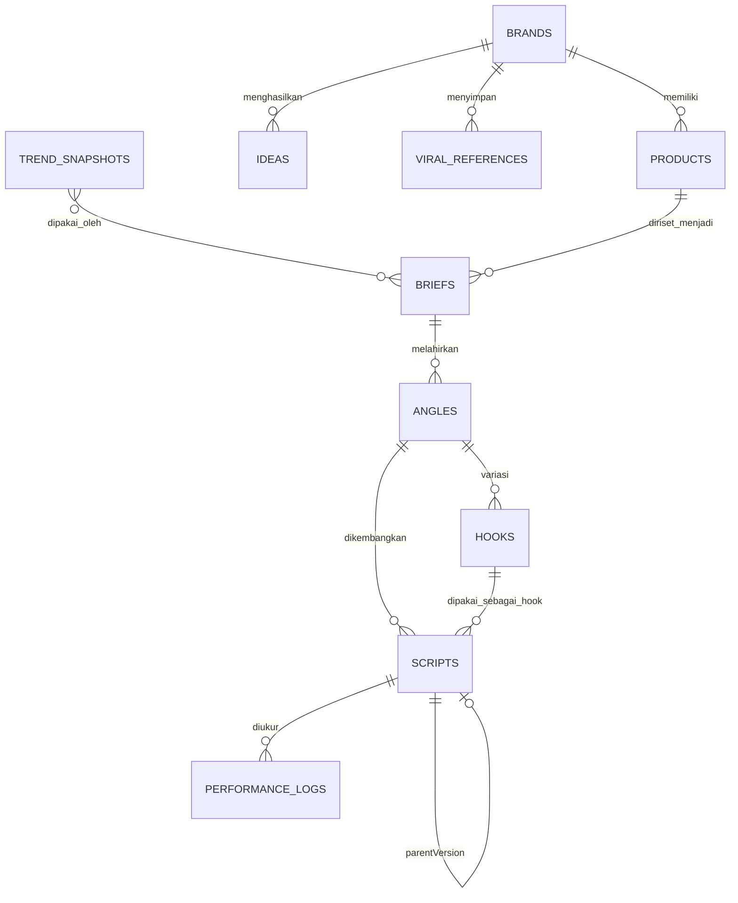

# ERD & Model Data — Affiliate Script Studio — V1

**Database:** Cloud Firestore (sinkron HP ↔ laptop). Menggantikan SQLite/Drizzle di versi lama karena SQLite (`better-sqlite3`) tidak bisa berjalan di Android dan tidak tersinkron antar perangkat.
**Dokumen pendamping:** `prd.md`, `design.md`, `agent.md`

## 1. Prinsip
- **Tanpa beban SaaS:** tidak ada `users/tenants/subscriptions`. Semua dokumen punya `ownerUid` dan Security Rules mengunci ke 1 email.
- **Koleksi top-level + field referensi** (bukan subkoleksi dalam). Satu pengguna = volume kecil; query lintas produk (bank hook, winning patterns) jadi sederhana.
- **Script versi = dokumen immutable.** Adegan (`scenes[]`) disimpan **di dalam** dokumen script (≤ 15 adegan, jauh di bawah batas 1 MB). Revisi = salin dokumen + `versionNo + 1`. Ini tetap "single source of truth" untuk tampilan CapCut/VO, teleprompter, dan ekspor JSON.
- **Sumber wajib:** setiap fakta produk dan item tren menyimpan asal-usulnya.
- **Server menulis, client membaca.** Semua tulisan hasil AI dilakukan server (Firebase Admin SDK). Client hanya boleh menulis koleksi input (brand, produk, performance log, viral reference) dan edit inline draft.
- **Validasi Zod** untuk setiap dokumen sebelum ditulis (skema di `src/shared/schemas/*`, dipakai server & client).
- Timestamp memakai `Timestamp` Firestore (`serverTimestamp()`), ID memakai auto-ID Firestore.

## 2. Diagram Relasi (logis)



## 3. Koleksi & Field

Notasi tipe: `string`, `number`, `bool`, `ts` (Timestamp), `ref<koleksi>` (string ID), `T[]` array, `?` opsional.

### `appConfig/owner` (1 dokumen)
| Field | Tipe | Catatan |
| :--- | :--- | :--- |
| `ownerEmail` | string | Email yang diizinkan (juga di-hardcode di Security Rules) |
| `monthlyBudgetUsd` | number | Default 10 (keputusan owner: hemat) |
| `activeBrandId` | ref<brands>? | Brand aktif terakhir |

### `brands`
| Field | Tipe | Catatan |
| :--- | :--- | :--- |
| `ownerUid` | string | |
| `accountName` | string | Nama akun TikTok/Shopee |
| `personaTone` | string | mis. "kakak yang jujur, santai, sedikit lucu" |
| `visualAesthetic` | string | |
| `targetAudience` | string | |
| `primaryPlatforms` | (`tiktok`\|`shopee`\|`reels`\|`shorts`)[] | default `['tiktok','shopee']` |
| `defaultFormat` | VideoFormat \| `auto` | default `auto` = AI memilih per angle |
| `faceMode` | `face`\|`faceless`\|`mixed` | default `mixed`; jika `mixed`, minimal 1 angle wajib bisa faceless |
| `voiceoverWpm` | number | 110–180, default 140 |
| `bannedPhrases` | string[] | preset klise affiliate Indonesia, bisa diedit |
| `contentPillars` | PillarType[] | |
| `styleExamples` | string[] | 2–5 contoh kalimat gaya bicara asli owner (memperkuat anti-template) |
| `cachedSystemBlock` | string | Blok XML statis untuk prompt caching, **dibangun ulang server setiap brand diubah** |
| `cachedSystemBlockTokens` | number | Estimasi token (ditampilkan di UI) |
| `createdAt` / `updatedAt` | ts | |

### `products`
| Field | Tipe | Catatan |
| :--- | :--- | :--- |
| `ownerUid`, `brandId` | string, ref<brands> | |
| `name` | string | |
| `category` | ProductCategory | dipakai Trend Pulse |
| `sourceUrl` | string? | |
| `marketplace` | `tiktok_shop`\|`shopee`\|`tokopedia`\|`lazada`\|`other`? | |
| `priceIdr` / `strikePriceIdr` | number? | |
| `commissionPct` | number? | |
| `promoNotes` | string? | voucher, gratis ongkir, periode kampanye |
| `scrapeStatus` | `pending`\|`success`\|`blocked`\|`manual_only` | |
| `scrapedSpecs` | map | hasil ekstraksi halaman (mentah) |
| `photoPaths` | string[] | path Firebase Storage, maks 5 |
| `manualDescription` | string | wajib jika link diblokir & tanpa foto |
| `creatorNotes` | string | **wajib** min. 1 kalimat pengalaman nyata |
| `createdAt` | ts | |

### `trendSnapshots`
| Field | Tipe | Catatan |
| :--- | :--- | :--- |
| `ownerUid` | string | |
| `category` / `platform` | ProductCategory / Platform | kunci cache |
| `items` | TrendItem[] | lihat bawah |
| `campaignMoments` | {name, dateRange, relevance}[] | Payday, 12.12, dst. |
| `expiresAt` | ts | `createdAt + 24 jam` |
| `createdAt` | ts | |

`TrendItem = { kind: 'format'|'hook_pattern'|'audio'|'topic'|'buyer_question', title, description, exampleStructure?, sourceUrl, observedAt }` — **`sourceUrl` wajib**.

### `viralReferences`
| Field | Tipe | Catatan |
| :--- | :--- | :--- |
| `ownerUid`, `brandId` | | |
| `url` / `pastedText` | string? | minimal salah satu |
| `extractedPattern` | {hookType, structure: string[], avgSceneSec, visualStyle, whyItWorks} | hasil analisis AI, **bukan salinan kalimat** |
| `tags` | string[] | |
| `createdAt` | ts | |

### `briefs`
| Field | Tipe | Catatan |
| :--- | :--- | :--- |
| `ownerUid`, `productId` | | |
| `trendSnapshotId` | ref<trendSnapshots>? | tren yang dipakai saat riset |
| `painPoints` / `buyingTriggers` / `objections` / `competitorGaps` | string[] | |
| `verifiedFacts` | VerifiedFact[] | **dikunci** setelah angle dibuat |
| `forbiddenClaims` | string[] | klaim yang tidak boleh dipakai (medis, absolut, dll.) |
| `rawSources` | {url, title}[] | |
| `editedByOwner` | bool | |
| `factsLocked` | bool | `true` setelah angle dibuat; server menolak edit `verifiedFacts` |
| `createdAt` | ts | |

`VerifiedFact = { id, text, source: 'user'|'photo'|'page'|'web', sourceUrl? }`

### `angles`
| Field | Tipe | Catatan |
| :--- | :--- | :--- |
| `ownerUid`, `briefId`, `productId` | | `productId` didenormalisasi untuk query |
| `angleTitle` | string | |
| `sellingStyle` | SellingStyle | |
| `videoFormat` | VideoFormat | |
| `targetAwareness` | `unaware`\|`problem_aware`\|`solution_aware`\|`product_aware`\|`most_aware` | |
| `whyItFits` | string | |
| `trendItemRefs` | string[] | judul/URL item tren yang dipakai |
| `productionNeeds` | {showsFace, needsPhysicalProduct, location?} | |
| `isSelected` | bool | |
| `createdAt` | ts | |

### `hooks`
| Field | Tipe | Catatan |
| :--- | :--- | :--- |
| `ownerUid`, `angleId`, `productId` | | |
| `psychologyType` | HookType | |
| `verbalHook` | string | ≤ 12 kata |
| `visualHook` | string | |
| `textOnScreen` | string | ≤ 6 kata |
| `inspiredBy` | string? | item tren / viral reference |
| `isFavorite` | bool | bank hook lintas produk |
| `createdAt` | ts | |

### `scripts` (immutable per versi, kecuali `status`, `performanceSummary`, dan edit inline saat `status = 'draft'`)
| Field | Tipe | Catatan |
| :--- | :--- | :--- |
| `ownerUid`, `productId`, `angleId` | | |
| `rootScriptId` | string | ID versi 1 (mengelompokkan semua versi) |
| `parentVersionId` | ref<scripts>? | null untuk v1 |
| `versionNo` | number | |
| `revisionReason` | string? | chip/instruksi revisi atau "manual_edit" |
| `selectedHookId` | ref<hooks>? | |
| `platformTargets` | Platform[] | default `['tiktok','shopee']` |
| `videoFormat` | VideoFormat | |
| `targetDurationSec` | number | default 25–40 (disimpan `{min, max}`) |
| `totalEstSec` | number | dihitung server dari kata ÷ WPM (pakai varian CTA terpanjang) |
| `scenes` | Scene[] | **sumber tunggal** |
| `postingPacks` | map Platform → {caption, hashtags: string[], pinnedComment} | satu entri per platform target |
| `strategicBreakdown` | {hookPsychology, emotionLogicTrigger, objectionHandling, ctaReasoning} | |
| `factsSnapshot` | VerifiedFact[] | salinan verifiedFacts saat dibuat |
| `audit` | Audit | hasil audit terakhir |
| `status` | `draft`\|`ready`\|`recorded`\|`posted` | `ready` hanya jika `audit.passed` |
| `createdAt` | ts | |

`Scene = { order, role: 'hook'|'agitate'|'proof'|'demo'|'objection_handle'|'offer'|'cta', durationSec, voiceoverText, onScreenText?, shot: {cameraAngle, movement?, props?}, brollCue, sfxCue?, transitionNote?, factIds: string[] }`
— `factIds` menautkan kalimat ke `VerifiedFact.id` (dasar audit fidelity).
— Adegan `role = 'cta'` **wajib** punya `ctaVariants: { [platform]: {voiceoverText, onScreenText} }` untuk setiap platform target; `voiceoverText` adegan itu berisi varian platform pertama. Adegan lain sama untuk semua platform.

`Audit = { clicheFlags: Finding[], policyRisks: Finding[], fidelityWarnings: Finding[], passed: bool, checkedAt: ts }`
`Finding = { sceneOrder?, quote, problem, severity: 'warn'|'risk', suggestedFix }`

### `performanceLogs`
| Field | Tipe | Catatan |
| :--- | :--- | :--- |
| `ownerUid`, `scriptId`, `productId` | | |
| `platform` | Platform | satu log per platform (script yang sama diposting ke TikTok & Shopee dicatat terpisah) |
| `postUrl` | string? | |
| `postedAt` | ts | wajib |
| `views`, `likes`, `comments`, `shares`, `productClicks`, `unitsSold` | number? | |
| `commissionIdr` | number? | |
| `score` | number | dihitung server: `unitsSold / views × 1000` (fallback `productClicks / views × 1000`) |
| `isWinning` | bool | top 20% skor 90 hari terakhir, dihitung ulang tiap log baru |
| `updatedAt` | ts | |

### `ideas`
`{ ownerUid, brandId, productId?, pillarType, title, premise, brandingGoal, status: 'idea'|'scripted'|'published'|'archived', createdAt }`

### `apiRuns` (log biaya, hanya ditulis server)
| Field | Tipe | Catatan |
| :--- | :--- | :--- |
| `ownerUid` | | |
| `entityType` / `entityId` | string | dokumen yang dihasilkan |
| `stageName` | `trend_pulse`\|`product_research`\|`brief_extract`\|`angles`\|`hooks`\|`script_draft`\|`audit`\|`partial_revise`\|`viral_extract`\|`ideas` | |
| `modelName` | string | model yang **benar-benar** menjawab (bisa model fallback) |
| `inputTokens` / `cacheReadTokens` / `cacheWriteTokens` / `outputTokens` | number | dari `response.usage` |
| `webSearchCount` | number | |
| `effort` | `low`\|`medium`\|`high` | effort yang dipakai panggilan ini |
| `escalatedFrom` | string? | ID `apiRuns` effort lebih rendah yang gagal cek kualitas (kosong jika bukan eskalasi) |
| `qualityGate` | {passed: bool, reasons: string[]}? | hasil cek kualitas deterministik setelah panggilan |
| `estCostUsd` | number | dihitung dari tabel harga di `agent.md` |
| `latencyMs` | number | |
| `status` | `success`\|`repaired`\|`failed`\|`refused` | |
| `errorMessage` | string? | |
| `monthKey` | string | `YYYY-MM` zona waktu **Asia/Jakarta** (bukan UTC), untuk total anggaran |
| `createdAt` | ts | |

## 4. Enum Bersama
- `Platform`: `tiktok`, `shopee`, `reels`, `shorts`
- `VideoFormat`: `talking_head`, `faceless_vo`, `pov`, `before_after`, `unboxing_first_impression`, `comparison`, `tutorial_demo`, `grwm_routine`, `listicle`
- `SellingStyle`: `soft_sell_cinematic`, `educational`, `problem_solution`, `storytelling`, `hard_sell`, `honest_review`, `comparison`
- `HookType`: `pattern_interrupt`, `relatable_pain`, `contrarian`, `proof_first`, `curiosity_gap`, `price_shock`, `social_proof`, `pov`
- `PillarType`: `education`, `storytelling`, `honest_compare`, `behind_scenes`, `trust_building`, `product_spotlight`
- `ProductCategory`: `skincare_beauty`, `fashion`, `gadget_elektronik`, `rumah_tangga`, `dapur`, `ibu_bayi`, `kesehatan_suplemen`, `hobi_olahraga`, `otomotif`, `makanan_minuman`, `lainnya`

## 5. Indeks Komposit (firestore.indexes.json)
| Koleksi | Field |
| :--- | :--- |
| `products` | `ownerUid` ASC, `createdAt` DESC |
| `trendSnapshots` | `ownerUid` ASC, `category` ASC, `platform` ASC, `createdAt` DESC |
| `scripts` | `rootScriptId` ASC, `versionNo` DESC |
| `scripts` | `productId` ASC, `createdAt` DESC |
| `hooks` | `ownerUid` ASC, `isFavorite` ASC, `createdAt` DESC |
| `performanceLogs` | `ownerUid` ASC, `postedAt` DESC |
| `apiRuns` | `ownerUid` ASC, `monthKey` ASC |

## 6. Security Rules (inti)

```
rules_version = '2';
service cloud.firestore {
  match /databases/{db}/documents {
    function isOwner() {
      return request.auth != null
        && request.auth.token.email == 'GANTI_DENGAN_EMAIL_ANDA'
        && request.auth.token.email_verified == true;
    }
    // Koleksi input: owner boleh baca & tulis
    match /{col}/{id} {
      allow read: if isOwner();
      allow write: if isOwner()
        && col in ['brands', 'products', 'viralReferences', 'performanceLogs', 'ideas'];
    }
    match /scripts/{id} {
      // Edit inline draft: teks saja, status tidak boleh disentuh client
      // (status 'ready' hanya diset server setelah audit lolos; setelah edit, UI wajib memanggil re-audit)
      allow update: if isOwner()
        && resource.data.status == 'draft'
        && request.resource.data.diff(resource.data).affectedKeys()
             .hasOnly(['scenes', 'postingPacks', 'totalEstSec']);
      // Tandai progres produksi: ready → recorded → posted
      allow update: if isOwner()
        && resource.data.status in ['ready', 'recorded']
        && request.resource.data.status in ['recorded', 'posted']
        && request.resource.data.diff(resource.data).affectedKeys().hasOnly(['status']);
    }
    // apiRuns, trendSnapshots, briefs, angles, hooks, scripts(create), appConfig: hanya server (Admin SDK melewati rules)
  }
}
```
> Firebase Storage rules mengikuti pola `isOwner()` yang sama untuk folder `products/{productId}/photos/*`.

## 7. Kontrak Ekspor JSON Remotion v1.0 (P2)
Diturunkan langsung dari `scripts.scenes` (tidak disimpan terpisah, dihitung saat ekspor), sehingga tidak bisa berbeda dari tampilan VO.

```json
{
  "schema_version": "1.0",
  "meta": { "script_id": "...", "version_no": 2, "platform": "tiktok", "aspect_ratio": "9:16", "fps": 30, "total_duration_sec": 28.5, "brand_aesthetic": "..." },
  "product": { "name": "...", "selling_style": "soft_sell_cinematic", "strict_fidelity_notes": ["...fakta dari factsSnapshot..."] },
  "scenes": [
    { "scene_order": 1, "scene_role": "hook", "start_sec": 0.0, "duration_sec": 3.5,
      "voiceover_text": "...", "on_screen_text": "...", "broll_prompt_cue": "...",
      "camera_angle": "...", "sfx_cue": "...", "transition_note": "..." }
  ]
}
```
Ekspor dibuat **per platform** (pengguna memilih TikTok/Shopee); adegan CTA memakai `ctaVariants[platform]`. Nama file: `<slug_produk>_v<versi>_<platform>.json`.
Validasi: `voiceover_text` dan `broll_prompt_cue` wajib dan tidak boleh kosong; `start_sec` = jumlah `duration_sec` adegan sebelumnya; ditolak jika `scenes` kosong.

## 8. Pemetaan dari ERD Lama
| Lama (SQLite) | Baru (Firestore) | Alasan |
| :--- | :--- | :--- |
| `brand_profiles` | `brands` | + `primaryPlatforms`, `faceMode`, `styleExamples` |
| `products` | `products` | + `category`, harga coret, komisi, promo, foto |
| `market_briefs` | `briefs` | fakta kini punya sumber; + `forbiddenClaims` |
| `angle_options` | `angles` | + format video, tren, kebutuhan rekaman |
| `hook_library` | `hooks` | + tipe hook affiliate, `inspiredBy` |
| `scripts` + `script_scenes` | `scripts.scenes[]` | versi immutable lebih sederhana di Firestore |
| `policy_checks` | `scripts.audit` | audit melekat ke versi |
| `api_runs` | `apiRuns` | + cache write, web search, fallback model, `monthKey` |
| `content_ideas` | `ideas` | tetap |
| — | `trendSnapshots`, `viralReferences`, `performanceLogs`, `appConfig` | **baru**: tren real-time & feedback penjualan |
